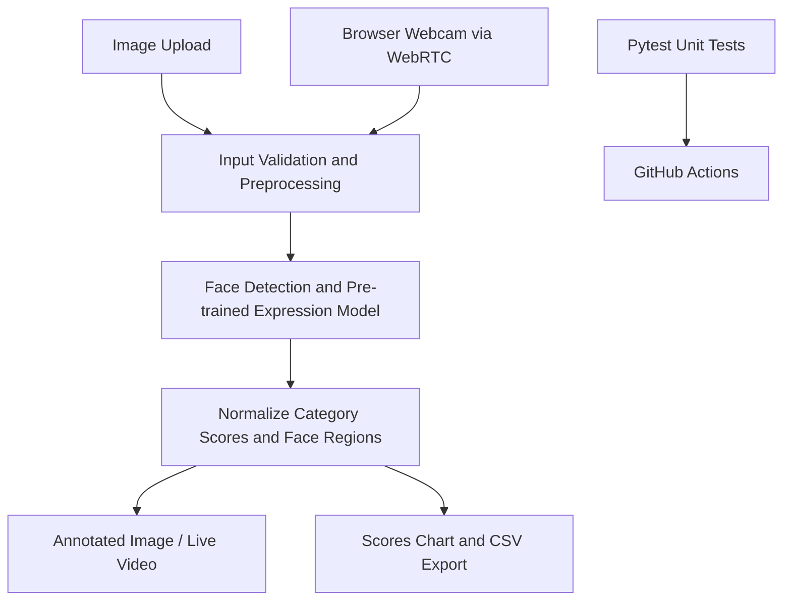

# System Architecture

## Components

- **Presentation:** Streamlit tabs for image analysis, webcam analysis, and project information.
- **Inference wrapper:** `emotion_engine.py`, validating images and normalizing DeepFace output.
- **Computer vision:** OpenCV colour conversion, bounding-box drawing, and image resizing.
- **Streaming:** streamlit-webrtc video processor that samples frames to limit inference load.
- **Tests:** mocked model responses, validation tests, multi-face normalization, and annotation checks.

## Data flow

The image is passed to the inference module in OpenCV BGR colour order. The module requests facial-expression analysis, normalizes scores and face regions, and returns results to the UI. The image-upload path stores the last result in Streamlit session state for rendering and CSV export. This application does not intentionally persist uploaded images or prediction history to disk.

## Known constraints

- Model weights are downloaded and cached by the model library according to its behaviour.
- First inference is slower due to model initialization.
- Live webcam inference is CPU intensive and samples only some frames.
- Remote WebRTC deployments may need HTTPS and additional network configuration.
- Output categories and scores depend on the underlying model version and are not validated measures of internal emotional state.
